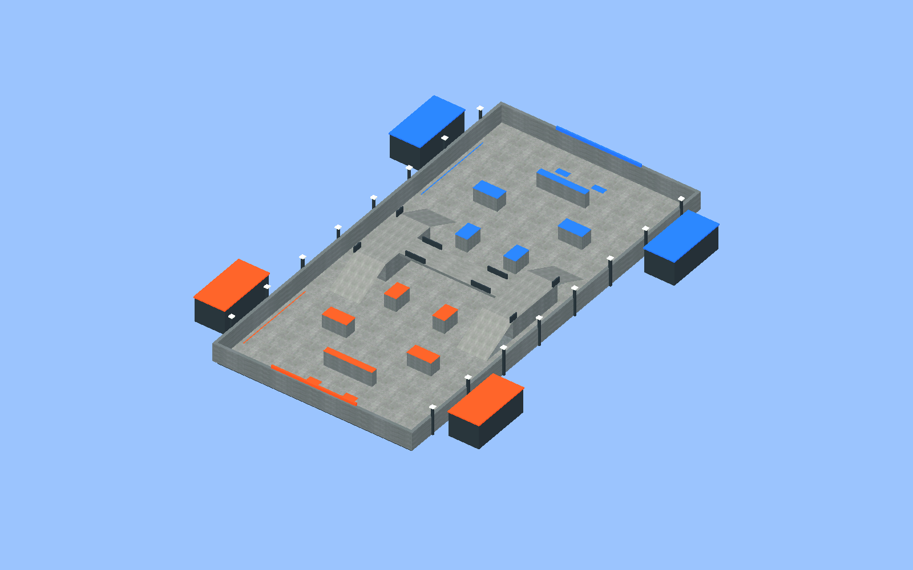
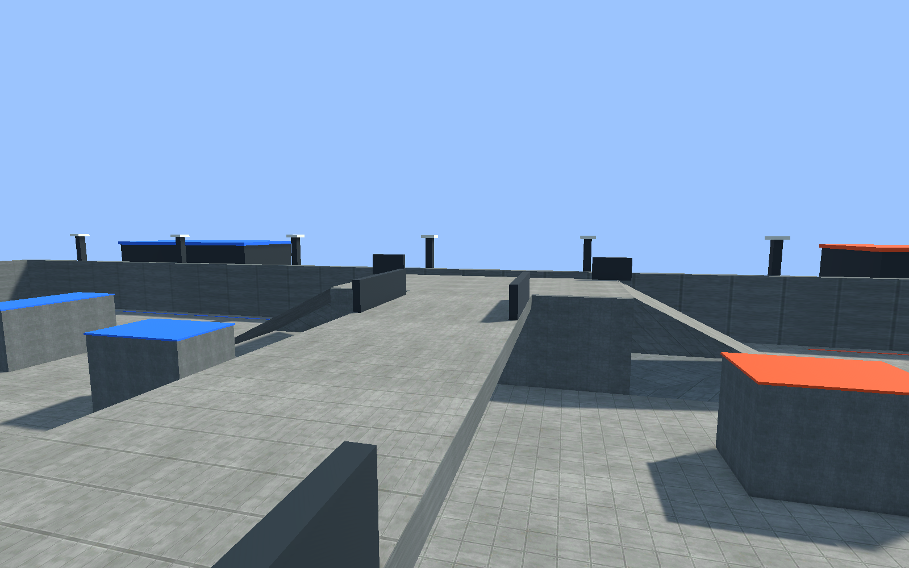
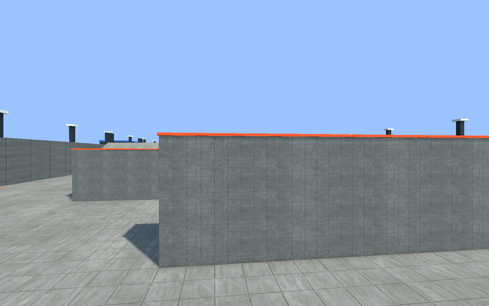

# 固定立体训练场

默认场景：`Assets/GameResource/Gameplay/maps/TrainingGround.unity`。地址：`maps/TrainingGround`。地图是已保存的 Unity Scene，启动、加载和构建过程不生成地图几何。

当前默认玩法为 [积木建造与拆毁](BlockGameplay.md)：固定地图提供地面和墙壁，动态积木在运行时生成、堆积、拆除和下落。比赛按存活积木数量结算；本页保留的旧涂色网格、面积和纹理数据仅供历史追溯。当前候选包与验证结果见 [首版状态](../Reports/BlockTerrain/FirstPlayableStatus20261013.md)。

## 编辑与运行

1. 通过 **喷墨对战 / 地图 / 打开立体训练场** 打开并编辑地图。
2. 修改几何、碰撞体、出生点或可行走表面后执行 **校验并烘焙当前地图**。表面 ID 必须稳定且唯一；可行走面使用单位缩放，尺寸在局部 X/Z 平面中以米计量。
3. 编辑场地配置时修改 Luban 源表，再运行 `cmd /c Config\Luban\gen_luban.bat`。
4. 从 `Assets/Scenes/Main/Boot.unity` 运行游戏，创建或加入房间即加载新地图。编辑地图 Scene 不要求进入运行模式。
5. **喷墨对战 / 构建 / Windows 正式资源版本** 构建 Addressables 与 Windows Player。已有地图不会被首次创建工具或旧资源安装器覆盖。

构建设置仍只有 Boot。进入房间时以 Additive 方式加载并设置战斗 Scene 为活动场景；退出时恢复 Boot、关闭会话并卸载地图。

## 布局与规则

| 项目 | 当前值 |
| --- | --- |
| 可玩边界 | X = -16～16 米，Z = -32～32 米 |
| 出生点 | 粉队南端、蓝队北端，各四个 |
| 高台与桥面 | 高 3 米，中央桥宽 4 米 |
| 坡道 | 四条，宽 5 米，水平长 6 米，坡度约 26.565° |
| 桥下净高 | 2.58 米 |
| 外侧绕行净宽 | 3 米 |
| 积木尺寸 | 边长 0.10 米；16³ 格稀疏区块，每块边长 1.6 米 |
| 积木顶界 | 基准地面以上 32 米，不设局部堆高限制 |
| 建造保护 | 出生和换装保护区对应的完整竖直列禁止生成，两队相同 |
| 当前计分 | 三分钟结束时比较双方存活积木数量；下落积木计入，重力移动不改变数量 |

地图地面和墙面可供建造首层，命中己方积木向命中面外侧继续堆积；贴地图墙面的首层锚固，突出部分依赖下方支撑，失去支撑后竖直下落。桥上桥下的结构保留真实三维位置与碰撞，不共享平面归属或面积分数。生成跳过玩家占据空间；出生和换装保护只禁止生成，不增加碰撞屋顶或删除已有积木。

只有稳定己方积木支持地面或墙面弦化及快速材料恢复。中立地图、敌方积木和下落积木不提供附着资格；下落积木可被攻击，但不承托角色。局部连续积木拟合弦化坡面，不跨越空洞；角色通行仍由真实积木碰撞决定，不增加天花板附着。32 米玩法顶界保留，32 米高塔和两万格级联的专属压力及最终碰撞验收已按用户要求整组后移，状态为 `user-deferred-not-accepted`，不记通过。

四人队伍出生点按粉队 0–3、蓝队 0–3 绑定。保留原有 X=±3 米位置，新增 X=±6 米位置，Z 仍为两端 ±28 米。已有场景使用“喷墨对战/地图/增补四人队伍出生点”增补并更新拓扑签名，不重建地图布局。训练场南侧 0/4/8/12/16 米标尺属于无碰撞装饰。

## 旧涂色系统数据（历史）

以下为旧固定表面涂色系统的布局、精度、面积、协议及内存记录，保留原值；不作为当前积木精度、比赛分数、弦化资格或候选包性能结论。当前源码玩家快照协议为 37、积木协议为 3，具体包身份与握手结果以实际构建记录为准。

| 项目 | 历史记录值 |
| --- | --- |
| 涂色表面 | 36 个，其中 15 个可行走计分表面 |
| 玩法区域 | 15 个原有计分区域，101 个新增非计分平面区域；含墙面与掩体顶面 |
| 归属精度 | 各平面局部网格 0.125 米 |
| 有效计分面积 | 约 2052.331 平方米，包含高台、桥面和坡道，排除烘焙的不可达区域 |
| 涂色纹理 | 约 32 像素/米，矩形 RT 与长墙分图集；常驻 91.49 MiB，含最坏检查点峰值 118.68 MiB |

地面分块保持每米 32 个绘制像素，与原地面密度一致。同一平面的相邻地块连续喷涂；桥面与桥下不共享归属。坡道按斜面实际面积统计，末端不足一个网格的部分按实际面积加权。障碍投影在 0.125 米采样精度下排除。墙壁、桥底和掩体侧面可喷涂但不计分；角色查询脚下实际碰撞表面来决定潜墨、回墨和敌墨减速。

出生区挡墙及前场、中央掩体的顶面直接使用可涂色混凝土，不再叠放固定粉色／蓝色盖板；顶面沿用已有的非计分涂色区域。

可行走面顶面与实体侧壁分别绑定。旧的单一 `Size` 配置已改为 `Width=32`、`Length=64`；当时场地布局版本为 4，墨水检查点格式为 5，玩家协议为 6。逐平面区域包含稳定 ID、原点、基底、尺寸、有效格与攀游开关，并参与检查点、增量墨迹和拓扑签名。边界、栏杆和桥底禁止攀游，内部竖直面与共面接缝可攀游。新增区域不参与计分。完整 CPU 归属网格及累计状态为 1,502,800 字节；未增加墨水 RT。训练场南侧新增 0/4/8/12/16 米标尺，属于无碰撞装饰。

## 地图版本 3 的历史验证记录（2026-09-11）

以下为地图落地时的验证，保留原时间与结果，不能转记为当前积木玩法通过；当时后续墨水修复版本 4 的验证见 [历史墨水修复报告](../Reports/Archive/2026-09-14/Docs/InkLook/Implementation.md)。

验证使用 Unity 6000.3.9f1，在独立副本中执行。交付 Scene、运行时代码和测试所用副本已核对一致；没有启动或关闭用户当前编辑器中的场景。

| 验证 | 结果与证据 |
| --- | --- |
| Luban | 源表 → 生成 C#/JSON 成功，矩形尺寸与版本一致 |
| Unity EditMode | **45 / 45 通过**；含矩形边界、斜面面积、不可达格、覆盖/清空、检查点、跨层隔离、地块接缝、高台跳落和外侧路线 |
| GPU | **36 / 36 表面通过**绘制、清空和纹理恢复；释放后 RT 计数为 0 |
| 实际角色模拟 | 图形版 Player 验证底层、桥面和坡道上的潜墨、回墨及敌墨减速 |
| 实际 CharacterController | 四坡道、高台、横桥和桥下通路通过；桥下相机避障通过 |
| Windows 构建 | Addressables 与 Windows Player 构建成功，输出 `Builds/Windows/InkLan.exe` |
| 同机双进程 | 完整 180 秒对局、结算和第二局启动通过；双方面积一致 |
| 多层同步 | 15 个可行走表面的 GPU 纹理哈希全部一致；归属哈希均为 `2952120506` |
| 中途加入 / 退出重进 | 初始检查点恢复成功；客户端两轮退出/重进成功 |
| 加载与卸载 | 房主三次创建/卸载成功；加载中取消得到预期提示；房主退出后客户端返回菜单 |
| 版本不一致 | 使用旧地图拓扑的客户端被明确拒绝 |

同机自动化测试不代替两台实体电脑的局域网验证；人工键鼠手感、长期对战平衡与两台实体电脑验收仍待进行。

可复查的本地证据位于 `Reports/Archive/2026-09-14/Logs/TrainingGround/`：`complete-tests.xml`、`gpu.log`、`acceptance-build.log`、`accepted-host.log`、`accepted-client.log`、`round-host.log`、`round-client.log`、`cycles.log`、`cancel.log`、`mismatch.log`。自动化涂地/通行诊断仅在开发构建显式传入 `-inkSmokeCase map` 和 `-lanSmokeHost/-lanSmokeClient` 时启用。

## 历史场景截图（旧涂色版本）

